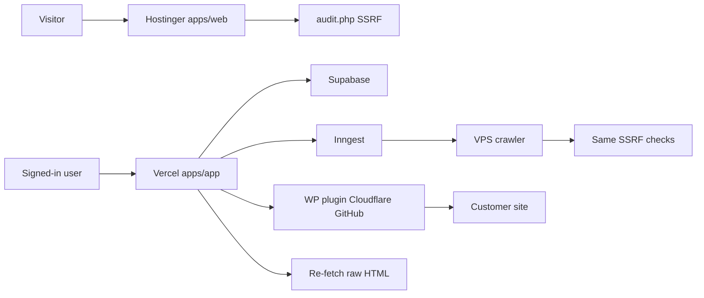

# SchemaCraft core product plan

## Progress

Speed mode: build M1 through Mention Map without waiting between them. Resume at the first unchecked line. Only M1 is published to schemacraft-ai.site. Later milestones stay off the deploy branch.

- [x] M1 — Ranked copy-paste on the live audit
- [ ] M2 — Save a site
- [ ] M3 — What the bot sees
- [ ] M4 — WordPress apply, rollback, and IndexNow
- [ ] M5 — Cloudflare channel
- [ ] M6 — Content drafts
- [ ] M7 — GitHub pull request
- [ ] M8 — Measure, payments, and Search Console
- [ ] M9 — Agency and Shopify
- [ ] Mention Map — Places competitors are cited

The core loop is diagnose, prioritize, generate a prefilled fix, apply only after approval, verify in raw HTML, then measure before and after. The first ship is a better one-URL fix on the live audit.

## Assumptions

- The phase roadmap in `docs/ROADMAP.md` stays paused. These milestones replace the build order. Public URLs stay frozen at the 56 URLs in `apps/web/lib/seo/public-urls.txt`.
- Hostinger keeps serving only `apps/web/out` from the `deploy` branch. `apps/app` stays off that branch. The radar link stays hidden until `NEXT_PUBLIC_RADAR_APP_LIVE=1`.
- The first real value is copy-paste on the existing one-URL audit, then a re-fetch. WordPress is the first one-click channel, then Cloudflare, then GitHub. Shopify is last and may stay copy-paste.
- Prices stay Free $0, Starter $19, Pro $49, Agency $149. Payments are an interface first: Lemon Squeezy for cards, plus a manual adapter for Egypt and the Gulf.
- The crawl worker runs on a VPS in Docker. The signed-in app stays a Vercel Next.js server. Jobs stay Inngest, inline when no key is set.
- Missing business facts are questions. The model never fills them in.
- Evidence labels: **proven** means a crawler or Google/OpenAI public rule depends on it. **Likely** means it matches how answer engines quote pages, without a citation guarantee. **Experimental** means we do not treat it as a ranking or citation factor.

## 1. Journeys

Shared loop for every user: enter a URL, see what the crawler got in raw HTML, do the top fix, approve it, re-fetch, see what changed. English and Arabic (RTL) on every screen. Anything not re-fetched stays "not assessed".

### Shop owner (no technical skill)

- Screen 1, public audit on schemacraft-ai.site: paste the URL. No account.
- Screen 2, result: three cards only. Each card is one sentence of why, the evidence quote, and a copy block already filled with their domain. A fourth line lists other issues as "later".
- Screen 3, questions: only if a fix needs a fact the page does not contain (legal name, phone, hours, sameAs). Skip the fix if they skip the question.
- Screen 4, "I pasted it": one button re-runs the same audit. Before/after shows only checks whose evidence changed. No ranking promise.
- Account is optional and only saves the site. The radar box stays absent until the app host is live.

### WordPress owner

- Same screens 1–3.
- Screen 4, connect: install SchemaCraft Connect, paste a site key. The plugin does not change the site yet.
- Screen 5, approve: a diff of the exact `wp_head` output or robots.txt lines. Approve one fix at a time.
- Screen 6, verify: the app re-fetches raw HTML with Googlebot and OAI-SearchBot user-agents and shows the snippet present or absent.
- Screen 7, rollback: one button restores the previous snippet. A failed verify rolls back on its own.

### Agency (10 clients)

- Screen 1, client list: domain, last audit, open fixes, plan. No white-label yet.
- Screen 2, one client uses the same diagnose, approve, and verify loop. The agency user approves; the client can be view-only.
- Screen 3, queue: fixes across clients, each with risk (robots.txt is high).
- Screen 4, before/after per client. PDF and logo wait until the measurement milestone. Ten clients is the Agency plan limit, enforced on the server.

## 2. Fix catalog

Each item is one fix type. Check ids already live in `packages/audit-core/src/audit/checks.ts`. Apply lists channels in the order we will build them. Verification is always a raw re-fetch with no JavaScript.

- **Allow AI and Google crawlers in robots.txt.** Evidence: parsed robots.txt and the bot verdict. Fix: the smallest extra `Allow` lines for Googlebot, Bingbot, OAI-SearchBot, PerplexityBot, Claude-SearchBot, and the user-triggered fetchers. Apply: copy, WordPress file, GitHub. Verify: same robots fetch, verdict becomes allow. Risk: high. User input: no. Priority: proven.
- **Training-bot policy.** Evidence: GPTBot, ClaudeBot, Google-Extended groups. Fix: a commented choice, not a silent block. Apply: copy. Verify: the chosen group matches the file. Risk: medium. User input: yes, block or allow. Priority: experimental for citations. It does not decide ChatGPT Search.
- **CDN or firewall blocking a crawler.** Evidence: live probe status, challenge page, or a different status per user-agent. Fix: a host-specific allow-list note. Apply: none. We cannot change Cloudflare or a host panel for them in v1. Verify: the probe returns the real page. Risk: high if they change it wrong. User input: they do it. Priority: proven.
- **noindex or nosnippet.** Evidence: meta robots and `X-Robots-Tag`. Fix: remove the blocking token, or leave it if the page is private. Apply: copy, WordPress head, Cloudflare inject, GitHub. Verify: token gone in raw HTML and headers. Risk: high. User input: yes if the page looks private. Priority: proven.
- **Canonical.** Evidence: canonical tag versus final URL. Fix: a self-canonical, or the chosen preferred URL. Apply: copy, head inject, GitHub. Verify: tag matches the chosen URL. Risk: medium. User input: only when several URLs could be preferred. Priority: proven for Google; likely for AI crawlers that honor it.
- **Title, meta description, H1.** Evidence: current tags and the visible H1 or first paragraph. Fix: a rewrite using only that text, within length limits. Apply: copy, head inject, GitHub. Verify: the new tag is in raw HTML. Risk: medium. User input: no, unless the page has no usable text. Priority: likely.
- **HTML lang, viewport, charset, favicon, social cards.** Evidence: the missing tag. Fix: a tag from `<html lang>`, the page title, and an image already on the page. Apply: copy, head inject. Verify: tag present. Risk: low. User input: image URL if none exists. Priority: likely for lang; experimental for favicon and social cards as citation factors.
- **hreflang.** Evidence: alternate links. Fix: pairs only for language URLs already linked on the site. Apply: copy, head inject, GitHub. Verify: tags match those URLs. Risk: medium. User input: yes if the other language URL is not linked. Priority: likely for multilingual Google; experimental for AI answers.
- **Image alt.** Evidence: images in raw HTML with empty alt. Fix: alt from the nearest heading or a question to the user. Apply: copy, GitHub. WordPress and Cloudflare do not rewrite body images in v1. Verify: alt present in raw HTML. Risk: low. User input: when no nearby text exists. Priority: likely for Google images; experimental for AI citations.
- **HTTPS, redirect chain, mixed content, meta refresh, TLS.** Evidence: status chain, certificate date, `http://` assets. Fix: a checklist for the host, not an injected tag. Apply: none, except mixed-content URLs we can list. Verify: the next audit shows one hop and HTTPS. Risk: high. User input: host access. Priority: proven for Google; likely for crawlers that drop insecure URLs.
- **Soft 404.** Evidence: the random URL probe. Fix: a server rule to return 404. Apply: copy, GitHub if the app has a not-found route. Verify: probe status is 404. Risk: medium. User input: no. Priority: likely.
- **Sitemap.** Evidence: sitemap status and whether this URL is listed. Fix: an XML snippet or a URL to add. Apply: copy, GitHub, WordPress if the plugin can write a virtual sitemap later. Verify: URL appears in the fetched sitemap. Risk: low. User input: no. Priority: likely.
- **Internal links.** Evidence: link count and the important URLs found on this page. Fix: suggested anchors only to URLs already on the site. Apply: copy, GitHub. Verify: the new href is in raw HTML. Risk: low. User input: which target, if several exist. Priority: likely.
- **JSON-LD for the page type.** Evidence: extracted name, description, URL, logo, address, price, and existing JSON-LD errors. Fix: one graph using only those fields. Types already in the schema tools: Organization, LocalBusiness, Product, Article, FAQ. Apply: copy, WordPress `wp_head`, Cloudflare inject, GitHub. Verify: the script is in raw HTML and validates. Risk: medium if it describes something not visible. User input: any required property the page does not contain. Priority: likely for eligibility. It is not a rich-result guarantee. Deprecated FAQ and HowTo rich results stay informational.
- **Organization identity and sameAs.** Evidence: name and any profile links on the page. Fix: Organization or LocalBusiness plus only the profile URLs we found. Apply: same as JSON-LD. Verify: raw HTML contains those URLs inside the script. Risk: medium. User input: yes for profiles, phone, hours, and legal name when absent. Priority: likely.
- **JavaScript-only content.** Evidence: text, headings, links, or JSON-LD present in the rendered page and absent in raw HTML. Fix: move that content into the server HTML. Apply: WordPress (render in PHP), GitHub (SSR), copy of the missing block. Cloudflare can inject a known block. It cannot invent the rendered text. Verify: the same strings exist in the no-JS fetch. Risk: high. User input: no. Priority: proven. AI crawlers do not run JavaScript.
- **Answer-first rewrite and FAQ.** Evidence: the page's own sentences plus radar questions the user saved. Fix: a first sentence, question headings, and an FAQ whose answers are quotes or close paraphrases of the page. Apply: copy, GitHub diff, WordPress as a draft. Verify: the approved sentences are in raw HTML. Risk: medium. User input: yes whenever a fact is not on the page. Priority: likely. Dry-run questions stay labeled as templates until a live radar run exists.
- **llms.txt.** Evidence: fetch status and content type. Fix: a markdown map of URLs already discovered. Apply: copy, GitHub. Verify: `/llms.txt` returns that file. Risk: low. User input: no. Priority: experimental. It stays low weight, matching the current check.
- **TTFB, compression, HTML weight, security headers.** Evidence: timing and headers. Fix: host instructions. Apply: none. Verify: the next audit's numbers. Risk: low. User input: host access. Priority: experimental for AI citations; likely only as a crawl-budget aid for Google.

## 3. Architecture

Reuse without moving it:

- `packages/audit-core`: checks, parser, robots rules, bot registry, JSON-LD validator, robots and llms builders.
- `apps/web/public/api/audit.php`: the only fetcher for the public one-URL audit. SSRF and the 20-audits-per-10-minutes limit stay.
- `apps/web/components/audit/FixModal.tsx`: the copy-paste pattern.
- `apps/app/lib/db/schema.sql`: users, sites, prompts, runs, mentions, fixes, subscriptions, usage_costs, and the RLS tests.
- `apps/app/lib/runner.ts`, parser, report, and the Inngest route: radar and jobs. Dry-run stays the default.

New, later, each behind the milestone that needs it:

- `packages/fixes`: pure functions from a check plus evidence to a fix draft. No network. Unit-tested with the existing audit fixtures.
- `packages/crawler`: Playwright plus a raw HTTP fetch, Docker, on a VPS. Imports the same SSRF predicate as audit.php, with a shared test vector. Not deployed to Hostinger or into the `deploy` branch.
- `packages/wp-plugin`: read-only until a fix is approved; prints approved snippets in `wp_head`; stores the previous value for rollback.
- `packages/edge-worker`: Cloudflare HTMLRewriter for approved head snippets, Miniflare tests.
- GitHub apply: a pull request from an approved diff. Token or GitHub App stored as an env var, never in the repo.
- Shopify: a later adapter. If the theme API cannot inject head HTML safely, the channel stays copy-paste.

Where it runs:

- Hostinger: static `apps/web` only. CI publish script stays as it is now.
- Vercel: `apps/app` and Inngest. No Playwright there.
- VPS: crawler container. The app enqueues; the worker calls back with stored HTML.
- Cloudflare: the customer's zone, only after they install the worker.
- Supabase: Postgres and Auth. Service role stays server-only.

Data added to the existing tables, still with RLS:

- `pages`: url, raw HTML hash, rendered HTML hash, fetched_at.
- `issues`: check id, evidence quote, severity, pages affected, effort, status.
- `fix_drafts`: artifact, missing questions, risk.
- `approvals` and `applications`: who approved, channel, previous body, applied body.
- `verifications`: crawler user-agent, raw snippet found or not.
- `change_log`: one row per apply, rollback, or failed verify.

Jobs: crawl, verify, and live radar go through Inngest. With no keys, verify for the public audit is the existing PHP re-fetch in the browser, and radar stays fixtures.

## 4. Safety

- Nothing is written to a customer site until that user approves that exact artifact.
- Every apply stores the previous bytes. Rollback writes those bytes back and verifies the old snippet returned.
- If the re-fetch does not contain the approved snippet, the fix is marked failed, rollback runs, and the report says the fix is not live. The score does not improve.
- robots.txt, noindex, and canonical changes show a full diff and the words "high risk" before the approve button.
- JSON-LD and FAQ text may only contain strings taken from the page or typed by the user. The generator's test fixture includes a missing phone number and expects a question, not a made-up number.
- The crawler copies the SSRF checks in audit.php (http/https, allowed ports, no credentials, DNS once, private IPs blocked, pinned resolve). The same vectors are a unit test.
- Public audit rate limit stays. Crawl rate is slow, identifies SchemaCraft, and obeys robots.txt except for the customer's own approved audit.
- A fix that only has a host checklist cannot be applied by us. The UI says the user must do it.
- The marketing deploy cannot publish `apps/app`, the crawler, or the plugin. A CI test already guards the publish step.

## 5. What is worth doing

Proven, do these first: crawler allowed in robots and not challenged by the firewall; the answer text exists in raw HTML; the page is indexable and HTTPS.

Likely, do these next: answer-first opening, question headings, lists, a canonical, a title that matches the H1, JSON-LD that matches visible facts, sitemap, internal links, language tag.

Experimental or low weight, do not lead with these: llms.txt, blocking training bots, favicon, security headers, deprecated FAQ rich results, social cards as a citation tactic.

## 6. Plans, limits, and cost

Costs below are estimates, not invoices. The code already uses a $0.02 fixture price and a $0.05 ceiling when a live provider omits usage.

- One public URL audit: no model call. About 8 to 15 HTTP fetches. Cost is hosting, already covered, and rate-limited.
- A 100-page crawl: worker time only, no model, until someone asks for a rewrite.
- One grounded rewrite: about $0.01 to $0.05 if the prompt is the page text plus the saved questions.
- One radar call: fixture $0.02. Live OpenAI web search or Perplexity Sonar is about $0.01 to $0.05 of tokens plus the provider's search fee. Before `SCHEMACRAFT_DRY_RUN=0`, measure ten real calls and set the free cap from that average. Today's free cap of $0.36 is 18 fixture calls, not a promise about live prices.

Limits, enforced on the server:

- Free: 1 URL, top 3 copy-paste fixes, one re-audit, no crawl, no apply channel, no live radar.
- Starter $19: 1 site, 50 pages, all copy-paste fixes, WordPress head fixes, radar budget $5 and 30 prompts.
- Pro $49: 3 sites, 500 pages, content drafts, Cloudflare and GitHub, radar budget $20 and 100 prompts.
- Agency $149: 10 client sites, all channels, radar budget $80 and 100 prompts. White-label PDF comes with the agency milestone, not on day one.

## 7. Milestones

Each one keeps `npm test` and `npm run build` green and the sitemap URL set unchanged. The radar link stays hidden.

- **M1, days. Ranked copy-paste on the live audit.** `packages/fixes` ranks issues by impact, pages (1 so far), and ease, and explains why in English and Arabic. Artifacts are prefilled from the audit payload. Missing facts become questions. "Check again" re-fetches and shows which checks changed. IndexNow is an optional copy-paste step on this screen (the same JSON body as `ping_indexnow.js`: host, key, keyLocation, urlList). It is not sent automatically. Acceptance: fixture page with a blocked OAI-SearchBot produces a robots snippet using that host; a missing phone becomes a question; a re-fetch fixture moves that check from fail to pass. Goes live on schemacraft-ai.site through the existing Hostinger pipeline. No new URL.
- **M2. Save a site.** The signed-in app stores the audit, drafts, and approvals in Supabase. Still copy-paste only. Acceptance: user A cannot read user B's drafts; dry-run with no keys. Not on the marketing sitemap. App host stays off until you attach it.
- **M3. What the bot sees.** VPS crawler, raw versus rendered, up to the plan's page cap. SSRF tests. Acceptance: a fixture whose text is injected by JavaScript is flagged invisible, and the highlight shows the missing block.
- **M4. WordPress apply and rollback.** Plugin prints only approved head snippets. Acceptance: a test site's raw HTML contains the snippet after approve and the old HTML after rollback. A failed verify rolls back. After a fix passes verification, submit the changed URLs to IndexNow. The submitter reuses the `ping_indexnow.js` body and stays on a dry-run fixture until an IndexNow key is set.
- **M5. Cloudflare channel.** Same approval and verify rules. Miniflare tests.
- **M6. Content drafts.** Answer-first and FAQ from page text and saved questions, diff, then the same apply channels. Acceptance: a fact not on the page is asked, not written.
- **M7. GitHub pull request.** One approved diff, one PR. Verify after merge by re-fetch.
- **M8. Measure.** Live radar only after keys and a measured price. Before/after share of voice with min and max. Gemini and Claude added here. Payments turned on. `NEXT_PUBLIC_RADAR_APP_LIVE=1` only when the app host answers. Optional Google Search Console connection for real before/after impressions and clicks per fixed page. With no OAuth client it stays a dry-run fixture and the report says Search Console is not assessed.
- **M9. Agency and Shopify.** Ten-client workspace. Shopify only if a theme or metafield inject is safe; otherwise it stays copy-paste.
- **Mention Map, after M9.** Collect the domains AI engines cite when they recommend competitors in radar runs, and turn them into a ranked list of places the customer should be mentioned, with why. Evidence: likely. Ahrefs found branded web mentions correlate 0.664 with AI Overview visibility, against 0.218 for backlinks. That is a correlation, not causation, and the screen says so. Acceptance: a fixture answer that cites pearl.example and not the customer ranks pearl.example as a place to be mentioned, and a run with no citations stays not assessed.

## 8. Risks and open questions

- A bad robots.txt or canonical can drop a site from Google. Those stay high risk and one at a time.
- The customer's firewall may block our worker IP. The report then says the crawl is not assessed, and the one-URL PHP audit still works.
- Live radar prices can exhaust the free cap immediately. M8 does not flip `SCHEMACRAFT_DRY_RUN` until ten measured calls exist.
- Shopify's theme rules may make one-click injection unsafe. The plan allows dropping that channel without blocking the others.
- Open: which VPS, and whether the first WordPress trial is your site or a volunteer customer. Neither blocks M1.
